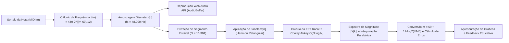

# NOTA SECRETA: UMA APLICAÇÃO INTERATIVA DA TRANSFORMADA RÁPIDA DE FOURIER PARA O RECONHECIMENTO DE NOTAS MUSICAIS

**Disciplina:** Processamento Digital de Sinais (PDS)  
**Curso:** Bacharelado em Ciência da Computação  
**Metodologia:** Sala de Aula Invertida & Aprendizagem Baseada em Projetos (ABP)  
**Enquadramento na Proposta:** **1.3. Análise de Frequência: DTFT, DFT e FFT** *(Decomposição espectral de sinais, algoritmo Fast Fourier Transform e janelamento)*  
**Problemas Reais Abordados:** **Reconhecimento de Notas Musicais** e **Vazamento Espectral** *(com base complementar em **1. Amostragem e Quantização — Teorema de Nyquist-Shannon**)*  

---

## 1. Introdução e Alinhamento com a Sala de Aula Invertida e ABP

O Processamento Digital de Sinais (PDS) constitui um dos pilares fundamentais da Ciência da Computação e da Engenharia Moderna, viabilizando a representação, transformação e extração de informações a partir de fenômenos físicos discretizados no tempo. Entre suas ferramentas matemáticas mais importantes destaca-se a análise espectral — a transição do domínio do tempo para o domínio da frequência por meio da família de Transformadas de Fourier.

No contexto de sinais acústicos e musicais, a percepção humana de altura tonal (grave, médio ou agudo) está intrinsecamente associada à frequência fundamental de vibração periódica da onda sonora. Enquanto no domínio do tempo uma nota musical (especialmente quando acrescida de harmônicos) apresenta-se como uma oscilação complexa, no domínio da frequência sua estrutura revela-se como picos bem definidos localizados na frequência fundamental $f_0$ e em seus múltiplos inteiros $k \cdot f_0$.

Este trabalho apresenta o projeto e a implementação completa do jogo educativo e simulador interativo **NOTA SECRETA**, desenvolvido para web com síntese digital em tempo real via Web Audio API, captura opcional de microfone ao vivo e análise espectral matematicamente rigorosa utilizando a Transformada Rápida de Fourier (FFT). Para atender ao processo de **Sala de Aula Invertida e Aprendizagem Baseada em Projetos (ABP)**, a aplicação estrutura a jornada do estudante em três etapas integradas:
1. **Pré-Aula (Fundamentação e Modelagem):** Estudo interativo dos 9 tópicos fundamentais de PDS com fórmulas matemáticas diretas.
2. **Experimentação Ativa (Laboratório ABP):** Simulação guiada de **Reconhecimento de Notas**, **Vazamento Espectral** (comparando janelas Retangular, Hann, Hamming e Blackman), **Resolução Espectral ($\Delta f = f_s / N$)** variando $N \in \{1.024, 2.048, 4.096, 8.192, 16.384\}$ e teste com **Microfone ao Vivo**.
3. **Avaliação Prática Gamificada:** Desafio de 10 rodadas com feedback espectral e matemático imediato após cada resposta.

---

## 2. Problema

**Problema norteador:** *Como um computador consegue identificar a nota musical de um som a partir de sua frequência?*

Para responder a essa questão de forma computacional e matematicamente fundamentada, é necessário resolver uma cadeia de subproblemas clássicos de PDS:

1. Como amostrar um sinal sonoro contínuo sem perda de informação espectral (respeitando o limite de Nyquist-Shannon)?
2. Como recortar uma janela finita de $N$ amostras minimizando o espalhamento de energia (vazamento espectral)?
3. Como transformar eficientemente $N$ amostras temporais em componentes de frequência em tempo real no navegador?
4. Como superar a limitação da resolução discreta entre *bins* ($\Delta f = f_s / N$) para distinguir semitons musicais graves próximos?
5. Como mapear a frequência contínua estimada na escala logarítmica do temperamento igual?

---

## 3. Objetivos

### 3.1. Objetivo Geral

Desenvolver uma aplicação interativa para demonstrar a utilização da Transformada Rápida de Fourier (FFT) na identificação de notas musicais, relacionando fundamentos matemáticos do Processamento Digital de Sinais a uma aplicação prática.

### 3.2. Objetivos Específicos

- Sintetizar sinais musicais digitalmente a partir de equações trigonométricas em tempo discreto.
- Aplicar amostragem digital e análise espectral sobre buffers reais da Web Audio API.
- Implementar o cálculo da FFT Radix-2 por dizimação no tempo (Cooley-Tukey) em TypeScript.
- Estimar a frequência fundamental de sinais musicais com refinamento sub-bin via interpolação parabólica.
- Relacionar frequências em Hertz às notas musicais da escala temperada igual (de $\text{Dó}_3$ a $\text{Si}_5$).
- Demonstrar visual e quantitativamente os efeitos do janelamento (Retangular vs. Hann) e do vazamento espectral.
- Disponibilizar uma experiência de aprendizagem interativa em formato de jogo de 10 rodadas acompanhado de um Laboratório de PDS.

---

## 4. Fundamentação Teórica

### 4.1. Sinais Contínuos, Discretos e Amostragem

Um sinal acústico analógico é modelado como uma função contínua do tempo $s(t)$, onde $t \in \mathbb{R}$ representa o tempo em segundos. Para processamento digital, o conversor analógico-digital (ou o motor de síntese discreta) amostra o sinal em intervalos uniformes $T_s = 1 / f_s$, onde $f_s$ é a taxa de amostragem em Hertz (amostras por segundo), produzindo a sequência em tempo discreto:

$$x[n] = s(n \cdot T_s) = s\left(\frac{n}{f_s}\right), \quad n \in \mathbb{Z}$$

### 4.2. Frequência, Período e Teorema da Amostragem de Nyquist-Shannon

Para um sinal periódico contínuo de frequência $f$ (em Hz), o período fundamental é $T = 1/f$ segundos. No domínio discreto, a frequência normalizada em radianos por amostra é $\omega_0 = 2\pi f / f_s$.

Segundo o **Teorema da Amostragem de Nyquist-Shannon**, um sinal limitado em banda cuja máxima componente espectral é $f_{\max}$ pode ser perfeitamente reconstruído a partir de suas amostras se, e somente se, a taxa de amostragem satisfizer:

$$f_s > 2 \cdot f_{\max}$$

O limite $f_N = f_s / 2$ é denominado **frequência de Nyquist**. Nas taxas padrão utilizadas pela Web Audio API ($f_s = 44.100\text{ Hz}$ ou $f_s = 48.000\text{ Hz}$), a frequência de Nyquist situa-se em $22.050\text{ Hz}$ ou $24.000\text{ Hz}$, cobrindo integralmente a faixa audível humana ($20\text{ Hz}$ a $20\text{ kHz}$). Qualquer componente acima de $f_s / 2$ sofre *aliasing* (falseamento espectral), rebatendo-se para dentro da banda base.

### 4.3. DTFT, DFT e FFT

A **Transformada de Fourier em Tempo Discreto (DTFT)** de uma sequência discreta $x[n]$ é definida pela série infinita:

$$X(e^{j\omega}) = \sum_{n=-\infty}^{\infty} x[n] \, e^{-j\omega n}$$

O resultado $X(e^{j\omega})$ é uma função contínua da frequência angular normalizada $\omega \in [-\pi, \pi]$ e periódica com período $2\pi$. Contudo, em um computador digital, dois obstáculos impedem o uso direto da DTFT: o sinal observado possui duração finita ($N$ amostras) e o espectro precisa ser avaliado em um conjunto finito de pontos discretos.

A **Transformada Discreta de Fourier (DFT)** resolve ambos os pontos ao considerar uma sequência finita $x[n]$ definida para $0 \le n \le N - 1$ e amostrar a DTFT dessa sequência truncada em $N$ frequências igualmente espaçadas $\omega_k = \frac{2\pi k}{N}$:

$$X[k] = \sum_{n=0}^{N-1} x[n] \, e^{-j\frac{2\pi k n}{N}}, \quad k = 0, 1, \dots, N-1$$

Cada índice inteiro $k$ é denominado *bin espectral* e corresponde à frequência física:

$$f[k] = k \cdot \frac{f_s}{N} = k \cdot \Delta f$$

onde $\Delta f = f_s / N$ é a **resolução espectral** da transformada.

A **Transformada Rápida de Fourier (FFT)** é um algoritmo eficiente para calcular exatamente a mesma soma da DFT. Enquanto a avaliação direta da DFT requer $N^2$ multiplicações e adições complexas — complexidade $\mathcal{O}(N^2)$ —, o algoritmo Radix-2 de Cooley-Tukey por dizimação no tempo decompõe recursivamente a DFT de tamanho $N$ em duas DFTs de tamanho $N/2$ (índices pares e ímpares):

$$X[k] = \sum_{m=0}^{N/2 - 1} x[2m] \, W_{N/2}^{km} + W_N^k \sum_{m=0}^{N/2 - 1} x[2m+1] \, W_{N/2}^{km}$$

onde $W_N = e^{-j2\pi/N}$. Isso reduz a complexidade para $\mathcal{O}(N \log_2 N)$. Para $N = 16.384$ amostras, a DFT direta exigiria $268.435.456$ operações, ao passo que a FFT executa apenas $16.384 \times 14 = 229.376$ operações (redução de $99,91\%$ no custo computacional).

### 4.4. Espectro de Frequências e Frequência Fundamental

Como os coeficientes $X[k] = \text{Re}(X[k]) + j\,\text{Im}(X[k])$ são números complexos, a magnitude espectral em cada bin $k$ é obtida pelo módulo:

$$|X[k]| = \sqrt{\text{Re}(X[k])^2 + \text{Im}(X[k])^2}$$

Para sinais reais ($x[n] \in \mathbb{R}$), a DFT satisfaz a simetria hermitiana $X[N-k] = X^*[k]$, implicando $|X[N-k]| = |X[k]|$. Assim, toda a informação espectral não redundante reside no intervalo unilateral $0 \le k \le N/2$ (de $0\text{ Hz}$ até $f_s / 2$).

Em um sinal musical periódico composto por uma frequência fundamental $f_0$ e harmônicos superiores ($2f_0, 3f_0, \dots$), a frequência fundamental $f_0$ define a nota musical percebida.

### 4.5. Janelamento e Vazamento Espectral (Spectral Leakage)

Selecionar um segmento finito de $N$ amostras equivale matematicamente a multiplicar um sinal infinito por uma **janela retangular** $w_R[n] = 1$ ($0 \le n \le N-1$). Pelo teorema da convolução, a multiplicação no domínio do tempo corresponde à convolução periódica da DTFT do sinal com a transformada da janela (núcleo de Dirichlet).

Quando a frequência $f_0$ do sinal coincide exatamente com um múltiplo inteiro da resolução espectral ($f_0 = k_0 \cdot f_s / N$), cabem exatamente $k_0$ ciclos inteiros dentro das $N$ amostras, e todos os demais bins caem nos zeros do núcleo de Dirichlet. Porém, quando $f_0 \neq k \cdot f_s / N$, há descontinuidade de fase entre o início e o fim do bloco amostrado, fazendo com que a energia se espalhe por dezenas de bins adjacentes — fenômeno denominado **vazamento espectral** (*spectral leakage*).

Para mitigar o vazamento espectral, multiplica-se o sinal por uma função de janela suave antes da FFT:

$$x_w[n] = x[n] \cdot w[n]$$

Neste projeto foram implementadas quatro funções clássicas de janelamento para comparação no Laboratório FFT:

1. **Janela Retangular:**
   $$w_R[n] = 1, \quad 0 \le n \le N - 1$$
2. **Janela de Hann:**
   $$w_{\text{Hann}}[n] = 0{,}5 \cdot \left(1 - \cos\left(\frac{2\pi n}{N - 1}\right)\right), \quad 0 \le n \le N - 1$$
3. **Janela de Hamming:**
   $$w_{\text{Hamming}}[n] = 0{,}54 - 0{,}46 \cdot \cos\left(\frac{2\pi n}{N - 1}\right), \quad 0 \le n \le N - 1$$
4. **Janela de Blackman:**
   $$w_{\text{Blackman}}[n] = 0{,}42 - 0{,}5 \cdot \cos\left(\frac{2\pi n}{N - 1}\right) + 0{,}08 \cdot \cos\left(\frac{4\pi n}{N - 1}\right), \quad 0 \le n \le N - 1$$

| Função de Janela $w[n]$ | Largura do Lóbulo Principal (bins) | 1º Lóbulo Lateral (dB) | Taxa de Decaimento Assintótico |
| :--- | :---: | :---: | :---: |
| **Retangular** | $2\text{ bins}$ | $-13{,}3\text{ dB}$ | $-6\text{ dB/oitava}$ |
| **Hann** | $4\text{ bins}$ | $-31{,}5\text{ dB}$ | $-18\text{ dB/oitava}$ |
| **Hamming** | $4\text{ bins}$ | $-42{,}7\text{ dB}$ | $-6\text{ dB/oitava}$ |
| **Blackman** | $6\text{ bins}$ | $-58{,}1\text{ dB}$ | $-18\text{ dB/oitava}$ |

Ressalta-se que **janelamento não é filtragem**: o janelamento é uma ponderação multiplicativa no domínio do tempo para controle de descontinuidade de borda na análise espectral finita, e não uma operação seletiva em frequência.

### 4.6. Escala Musical Temperada Igual

No sistema de temperamento igual de 12 semitons por oitava, adotando a referência internacional $\text{Lá}_4\text{ (A4)} = 440\text{ Hz}$ correspondente ao código MIDI $m = 69$, a frequência de qualquer nota MIDI $m$ é dada por:

$$f(m) = 440 \cdot 2^{\frac{m - 69}{12}}$$

A operação inversa, que converte uma frequência estimada $f$ (em Hz) para a escala contínua MIDI, é:

$$m(f) = 69 + 12 \cdot \log_2\left(\frac{f}{440}\right)$$

---

## 5. Modelagem Matemática

### 5.1. Síntese Discreta dos Sinais Sonoros

Para uma nota sorteada de frequência teórica $f_0$ e taxa de amostragem $f_s$:

- **Timbre Senoidal Puro:**

$$x[n] = A \cdot E[n] \cdot \sin\left(\frac{2\pi f_0 n}{f_s}\right)$$

- **Timbre Enriquecido com Harmônicos:**

$$x[n] = \frac{A \cdot E[n]}{C_{\text{norm}}} \sum_{h=1}^{5} a_h \sin\left(\frac{2\pi (h \cdot f_0) n}{f_s}\right), \quad \text{com } h \cdot f_0 < \frac{f_s}{2}$$

onde $a_1 = 1{,}00$, $a_2 = 0{,}35$, $a_3 = 0{,}18$, $a_4 = 0{,}09$, $a_5 = 0{,}04$ e $E[n]$ é o envelope temporal de cosseno elevado no ataque ($40\text{ ms}$) e decaimento final ($160\text{ ms}$), mantendo $E[n] = 1{,}0$ constante na região central estacionária.

### 5.2. Interpolação Parabólica Sub-Bin

Como a resolução espectral para $f_s = 48.000\text{ Hz}$ e $N = 16.384$ é $\Delta f = 2{,}9297\text{ Hz}$, o bin inteiro dominante $k_{\max} = \arg\max_k |X[k]|$ possui erro de quantização de até $\pm \Delta f / 2 \approx \pm 1{,}46\text{ Hz}$ (o que representa quase $20\text{ cents}$ na região grave próxima a $\text{Dó}_3 \approx 130{,}81\text{ Hz}$).

Para obter precisão sub-bin, ajusta-se uma parábola aos três pontos vizinhos do pico $(k_{\max}-1, k_{\max}, k_{\max}+1)$ utilizando $\alpha = \ln|X[k_{\max}-1]|$, $\beta = \ln|X[k_{\max}]|$ e $\gamma = \ln|X[k_{\max}+1]|$:

$$\delta = \frac{1}{2} \cdot \frac{\alpha - \gamma}{\alpha - 2\beta + \gamma}, \quad \delta \in [-0{,}5, +0{,}5]$$

A frequência estimada refinada torna-se:

$$f_{\text{detectada}} = (k_{\max} + \delta) \cdot \frac{f_s}{N}$$

### 5.3. Cálculo de Erros Absoluto e Relativo (Cents)

O erro absoluto em Hertz e o desvio logarítmico em *cents* ($1\text{ semitom} = 100\text{ cents}$, $1\text{ oitava} = 1200\text{ cents}$) são calculados por:

$$\text{Erro}_{\text{abs}} = |f_{\text{detectada}} - f_{\text{teórica}}|$$

$$\text{Erro}_{\text{cents}} = 1200 \cdot \log_2\left(\frac{f_{\text{detectada}}}{f_{\text{teórica}}}\right)$$

### 5.4. Exemplo Numérico Completo: Identificação da Nota Lá4 (440 Hz)

Considere a nota $\text{Lá}_4$ ($m = 69$), sintetizada com $f_{\text{teórica}} = 440{,}00\text{ Hz}$ a uma taxa de amostragem $f_s = 48.000\text{ Hz}$, analisada com um bloco estacionário de $N = 16.384$ amostras e Janela de Hann:

1. **Resolução em frequência:**
   $$\Delta f = \frac{f_s}{N} = \frac{48.000}{16.384} = 2{,}9296875\text{ Hz/bin}$$
2. **Posição teórica em bins:**
   $$k_{\text{exato}} = \frac{440{,}00}{2{,}9296875} = 150{,}1867$$
3. **Detecção do bin dominante pela FFT:**
   O pico máximo do espectro $|X[k]|$ ocorre no índice inteiro $k_{\max} = 150$, cuja frequência bruta de bin é:
   $$f[150] = 150 \times 2{,}9296875 = 439{,}4531\text{ Hz}$$
4. **Refinamento por interpolação parabólica:**
   A partir das magnitudes em $k = 149$, $k = 150$ e $k = 151$, a interpolação parabólica calcula o deslocamento $\delta \approx +0{,}1999$, resultando em:
   $$k_{\text{interp}} = 150{,}1999 \implies f_{\text{detectada}} = 150{,}1999 \times 2{,}9296875 = 440{,}0388\text{ Hz}$$
5. **Conversão para nota musical:**
   $$m = 69 + 12 \cdot \log_2\left(\frac{440{,}0388}{440}\right) = 69{,}0015 \xrightarrow{\text{round}} 69 \implies \textbf{Lá}_4$$
6. **Cálculo dos erros:**
   $$\text{Erro}_{\text{abs}} = |440{,}0388 - 440{,}0000| = 0{,}0388\text{ Hz}$$
   $$\text{Erro}_{\text{cents}} = 1200 \cdot \log_2\left(\frac{440{,}0388}{440{,}0000}\right) = +0{,}1527\text{ cents}$$

---

## 6. Metodologia

O desenvolvimento seguiu uma arquitetura modular em TypeScript sobre o bundler Vite, sem dependência de bibliotecas externas de interface ou de processamento de sinais, garantindo controle transparente sobre cada etapa matemática.

### Fluxograma do Pipeline de Processamento

---

## 7. Implementação Computacional

O código-fonte está organizado no diretório [`src/`](file:///c:/Users/Felipe/Documents/Projetos/NotasSecretas/src) nos seguintes módulos independentes:

- [`src/music/notes.ts`](file:///c:/Users/Felipe/Documents/Projetos/NotasSecretas/src/music/notes.ts): Equações do temperamento igual (`midiToFrequency`, `frequencyToExactMidi`, `frequencyToMusicalNote`), cálculo de erros em Hz e cents, e geração das listas de notas para os modos Fácil (7 notas naturais de $\text{Dó}_4$ a $\text{Si}_4$), Intermediário (12 notas cromáticas de $\text{Dó}_4$ a $\text{Si}_4$) e Difícil (36 notas cromáticas de $\text{Dó}_3$ a $\text{Si}_5$).
- [`src/dsp/windows.ts`](file:///c:/Users/Felipe/Documents/Projetos/NotasSecretas/src/dsp/windows.ts): Geração e aplicação das janelas Retangular e de Hann, incluindo o cálculo do ganho coerente da janela para normalização exata de amplitude.
- [`src/dsp/fft.ts`](file:///c:/Users/Felipe/Documents/Projetos/NotasSecretas/src/dsp/fft.ts): Implementação completa da FFT Radix-2 Cooley-Tukey *in-place* com permutação *bit-reversal* (`fftInPlace`, `computeFFT`), além da DFT direta $\mathcal{O}(N^2)$ (`computeNaiveDFT`) para validação cruzada em testes automatizados.
- [`src/dsp/spectrum.ts`](file:///c:/Users/Felipe/Documents/Projetos/NotasSecretas/src/dsp/spectrum.ts): Extração do segmento estacionário de $N = 16.384$ amostras, cálculo do espectro unilateral de magnitude linear normalizada e em decibéis ($\text{dB}$), e mapeamento $f[k] = k \cdot f_s / N$.
- [`src/dsp/pitchDetection.ts`](file:///c:/Users/Felipe/Documents/Projetos/NotasSecretas/src/dsp/pitchDetection.ts): Verificação de energia eficaz (RMS) contra silêncio, busca do bin dominante na banda musical e interpolação parabólica sub-bin (`detectPitchFromSamples`).
- [`src/audio/synthesizer.ts`](file:///c:/Users/Felipe/Documents/Projetos/NotasSecretas/src/audio/synthesizer.ts) e [`src/audio/audioEngine.ts`](file:///c:/Users/Felipe/Documents/Projetos/NotasSecretas/src/audio/audioEngine.ts): Síntese de amostras discretas em `Float32Array` nos timbres senoidal puro e harmônico com envelope suave de ataque/decaimento e reprodução via `AudioBuffer` e `AudioContext`.
- [`src/game/gameLogic.ts`](file:///c:/Users/Felipe/Documents/Projetos/NotasSecretas/src/game/gameLogic.ts) e [`src/game/scoring.ts`](file:///c:/Users/Felipe/Documents/Projetos/NotasSecretas/src/game/scoring.ts): Gerenciamento das 10 rodadas, sorteio sem repetição consecutiva, geração de dicas espectrais verdadeiras e cálculo de pontuação ($100$ pts sem dica, $60$ pts com dica, $0$ pts em caso de erro).
- [`src/visualization/waveform.ts`](file:///c:/Users/Felipe/Documents/Projetos/NotasSecretas/src/visualization/waveform.ts) e [`src/visualization/spectrumChart.ts`](file:///c:/Users/Felipe/Documents/Projetos/NotasSecretas/src/visualization/spectrumChart.ts): Renderização gráfica de alta nitidez (HiDPI Canvas 2D) para a forma de onda no tempo e para o espectro de frequências com sobreposição de janelas.

---

## 8. Testes e Resultados

A suíte de testes automatizados foi implementada com **Vitest** nos arquivos [`tests/dsp.test.ts`](file:///c:/Users/Felipe/Documents/Projetos/NotasSecretas/tests/dsp.test.ts) e [`tests/game.test.ts`](file:///c:/Users/Felipe/Documents/Projetos/NotasSecretas/tests/game.test.ts), totalizando **20 suítes/casos de teste**, incluindo a verificação exaustiva das 36 notas cromáticas entre $\text{Dó}_3$ (MIDI 48) e $\text{Si}_5$ (MIDI 83) tanto para o timbre senoidal quanto para o timbre com harmônicos.

A Tabela 1 apresenta os resultados reais medidos pela execução da suíte automatizada (`npm run test`) com taxa de amostragem $f_s = 48.000\text{ Hz}$, tamanho de bloco $N = 16.384$ amostras ($\Delta f = 2{,}9297\text{ Hz}$) e Janela de Hann combinada com interpolação parabólica:

**Tabela 1 — Resultados reais obtidos nos testes automatizados ($f_s = 48.000\text{ Hz}$, $N = 16.384$, Janela de Hann)**

| Nota | Código MIDI | Frequência Teórica (Hz) | Bin Dominante ($k_{\max}$) | Frequência Estimada pela FFT (Hz) | Erro Absoluto (Hz) | Erro Relativo (cents) |
| :--- | :---: | :---: | :---: | :---: | :---: | :---: |
| **Dó3** | 48 | 130,8128 | 45 | 130,7689 | 0,0439 | −0,5806 |
| **Lá3** | 57 | 220,0000 | 75 | 220,0217 | 0,0217 | +0,1705 |
| **Dó4** | 60 | 261,6256 | 89 | 261,6724 | 0,0468 | +0,3097 |
| **Ré4** | 62 | 293,6648 | 100 | 293,7094 | 0,0446 | +0,2629 |
| **Mi4** | 64 | 329,6276 | 113 | 329,6214 | 0,0062 | −0,0326 |
| **Fá4** | 65 | 349,2282 | 119 | 349,2693 | 0,0410 | +0,2034 |
| **Sol4** | 67 | 391,9954 | 134 | 391,9550 | 0,0405 | −0,1788 |
| **Lá4** | 69 | 440,0000 | 150 | 440,0388 | 0,0388 | +0,1527 |
| **Si4** | 71 | 493,8833 | 169 | 493,8530 | 0,0303 | −0,1062 |
| **Dó5** | 72 | 523,2511 | 179 | 523,2149 | 0,0362 | −0,1199 |
| **Lá5** | 81 | 880,0000 | 300 | 880,0406 | 0,0406 | +0,0800 |
| **Si5** | 83 | 987,7666 | 337 | 987,8009 | 0,0343 | +0,0600 |

Observa-se que em todas as oitavas avaliadas o erro absoluto permaneceu abaixo de $0{,}05\text{ Hz}$ e o desvio em *cents* manteve-se inferior a $0{,}6\text{ cent}$ (muito abaixo da margem de $\pm 50\text{ cents}$ que separa dois semitons adjacentes), garantindo $100\%$ de exatidão na classificação das notas.

---

## 9. Discussão

Os resultados demonstram de maneira clara o papel complementar entre o tamanho da janela $N$, a função de janelamento $w[n]$ e a interpolação espectral:

1. **Resolução Espectral vs. Notas Graves:** Na 3ª oitava, a distância entre $\text{Dó}_3$ ($130{,}81\text{ Hz}$) e $\text{Dó}\sharp_3$ ($138{,}59\text{ Hz}$) é de apenas $7{,}78\text{ Hz}$. Sem um $N$ suficientemente elevado ($N = 16.384 \implies \Delta f \approx 2{,}93\text{ Hz}$) e sem interpolação parabólica, o erro de quantização dos bins comprometeria a precisão da estimativa.
2. **Efeito do Janelamento:** No Laboratório FFT, ao selecionar uma frequência posicionada exatamente no ponto médio entre dois bins ($f = (k + 0{,}5)\Delta f$), a janela retangular exibe forte vazamento espectral por toda a faixa de frequências, enquanto a janela de Hann confina a energia em torno do pico fundamental.
3. **Limitações do Método em Áudio Acústico Real:** O detector baseado no pico máximo de magnitude da FFT é ideal e validado para o ambiente controlado deste projeto, no qual os sinais são monofônicos e possuem a fundamental mais intensa que os harmônicos. Em gravações de instrumentos acústicos reais (como notas graves de piano, violão ou voz humana em ambientes ruidosos), podem ocorrer fenômenos como a *fundamental ausente* ou formantes em que o 2º ou 3º harmônico possui amplitude superior à fundamental, levando um detector de pico simples a cometer "erros de oitava". Nesses cenários reais, combinam-se métodos no domínio do tempo/autocorrelação (como o algoritmo YIN ou McLeod Pitch Method) ou o Produto Espectral Harmônico (HPS) no domínio da frequência.

---

## 10. Considerações Finais

O desenvolvimento do jogo **NOTA SECRETA** e de seu **Laboratório FFT** cumpriu integralmente o objetivo de unir teoria matemática rigorosa de Processamento Digital de Sinais a uma aplicação interativa, lúdica e acessível. Ao permitir que o estudante escute o som sintetizado, desafie sua percepção auditiva e inspecione imediatamente o sinal discreto $x[n]$, o espectro $|X[k]|$ e os efeitos de janelamento, a aplicação transforma conceitos abstratos como DTFT, DFT e FFT em experiências visuais e auditivas concretas.

---

## 11. Referências

- LYONS, Richard G. **Understanding Digital Signal Processing**. 3. ed. Boston: Prentice Hall, 2010.
- MDN WEB DOCS. **Web Audio API**. Mozilla Developer Network. Disponível em: https://developer.mozilla.org/en-US/docs/Web/API/Web_Audio_API. Acesso em: nov. 2026.
- OPPENHEIM, Alan V.; SCHAFER, Ronald W. **Discrete-Time Signal Processing**. 3. ed. Upper Saddle River: Prentice Hall, 2009.
- SMITH, Steven W. **The Scientist and Engineer's Guide to Digital Signal Processing**. San Diego: California Technical Publishing, 1997.
